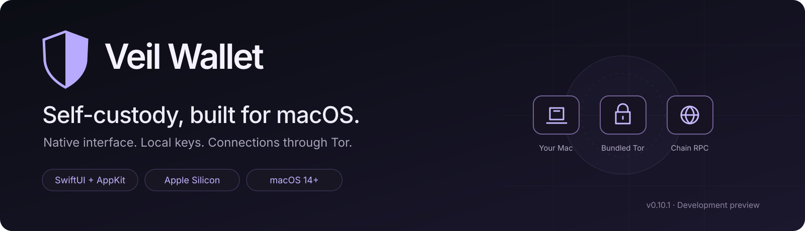
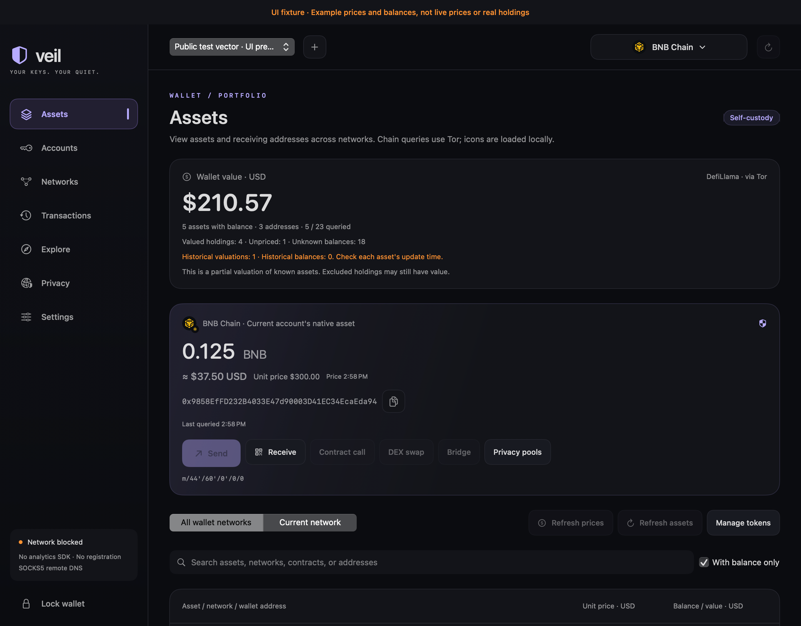
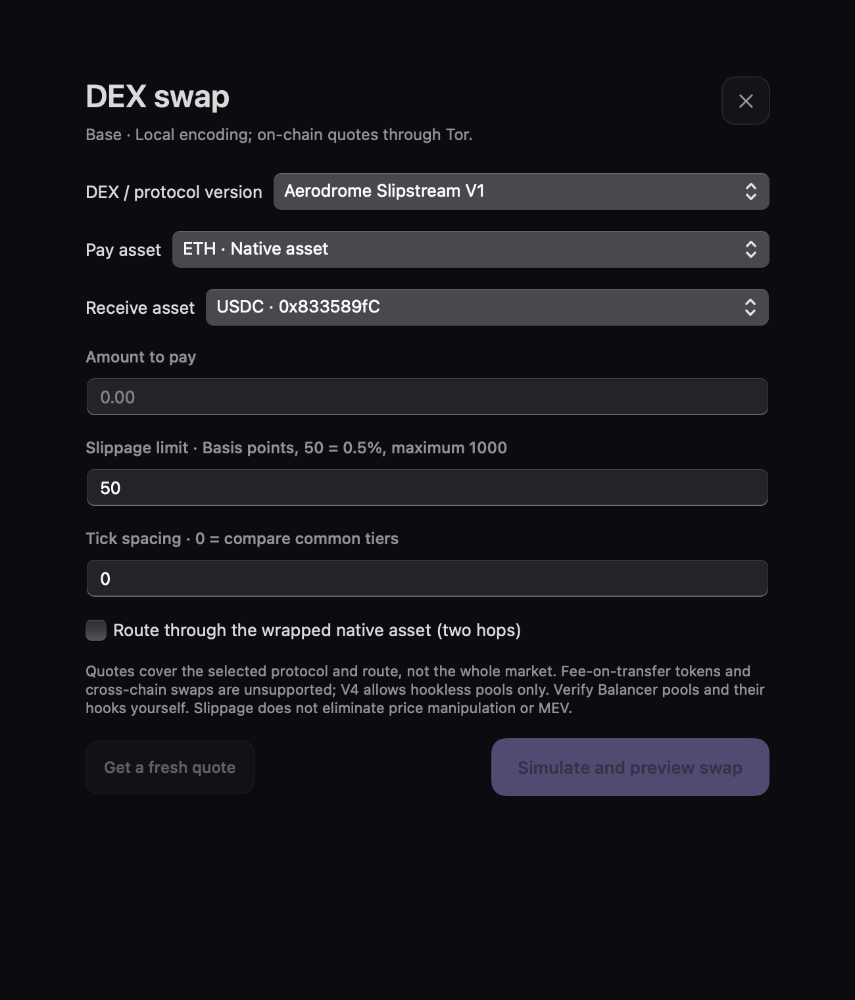
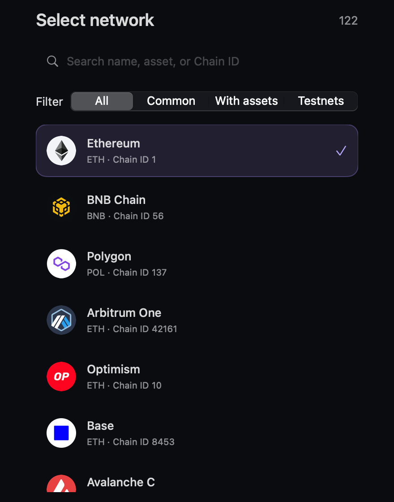
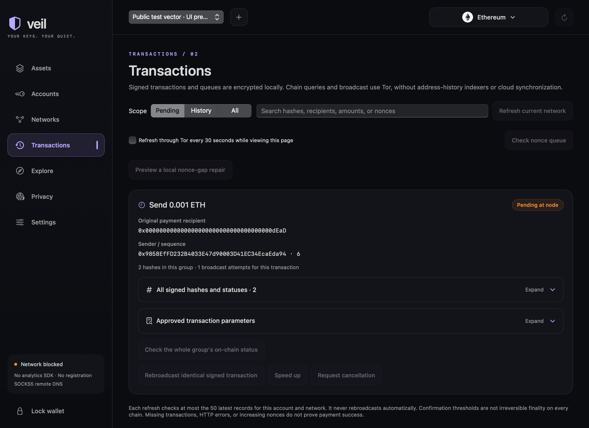

[Features](#what-you-can-do) · [Install](#install) · [Build](#build-from-source) · [Privacy](#privacy-and-local-data) · [Contribute](CONTRIBUTING.md)

**A native macOS wallet for local keys, multichain assets and Tor-routed connections.**

Veil Wallet brings wallet management, portfolio tracking, supported transfers and on-chain interactions into a SwiftUI/AppKit desktop app. English and Simplified Chinese switch immediately. No account registration, analytics SDK, embedded browser or runtime artwork downloads.

**v0.10.5 · Development preview · macOS 14+ · Apple Silicon.** The project has not undergone an independent security audit, Apple notarization or complete live-funds acceptance. Read the [security model](Documentation/SECURITY.md) before using it.

*Offline product preview using public test fixtures. Amounts and prices are illustrative; these images contain no real user wallet. Never fund published fixture addresses.*

## What you can do

| Area | Available in this preview |
|---|---|
| **Manage your keys** | Create/import English BIP39 phrases, supported private-key formats or watch-only addresses. Multiple wallets, address previews, password-protected backup display and wallet management. |
| **See your assets** | Native balances, 59 EVM/TRON token presets, manual tokens, local icons, searchable networks, USD unit prices and partial/stale-aware portfolio valuation. |
| **Send and manage transactions** | Supported EVM, BTC/LTC, SOL, TRX, APT, Cosmos Bank and XMR flows. Encrypted local archives, receipt checks and protocol-specific recovery actions. |
| **Interact on-chain** | Typed EVM calls, 82 configured EVM DEX deployments, TRON SunSwap/SUN routes and separate approval-to-swap confirmation. |
| **Bridge supported assets** | Fixed USDT routes ETH↔TRON and ETH↔BSC, with separate source and destination verification. |
| **Use supported privacy pools** | Fixed-denomination Classic ETH/BNB pools, separate note backups, bundled offline proving and direct withdrawals. |
| **Control the desktop experience** | Configurable idle lock, default 30 minutes; local settings, keyboard navigation, full-row disclosures and immediate language switching. |

The catalog contains **81 EVM mainnets, Sepolia, 39 non-EVM networks and Nostr identities**. Catalog presence, import, balance lookup and sending are different capabilities. The [complete network matrix](Documentation/PRODUCT_SCOPE.md) is the authority for individual chains.

### Swaps and network discovery

| Native swap forms | Searchable network selection |
|:--:|:--:|
|  |  |
| Quotes, exact approvals and swaps are separate steps. | Search by name, symbol or chain ID; filter popular, funded and test networks. |

EVM swaps use supported fixed deployments and local calldata construction. TRON SUN uses a Tor-routed candidate-route service with local validation. An approval is not a completed swap: verify its receipt, obtain a fresh quote and confirm the next signature. See [DEX versions and limits](Documentation/DEX.md).

### Transactions you can inspect

Transactions stay in an encrypted local queue and archive. Supported tools include same-payload manual rebroadcast, EVM nonce queues/speed-up/cancellation and transparent BTC/LTC RBF/single-level CPFP. Unknown broadcast results retain their original hash; the app does not automatically repeat a payment.

[Transaction management](Documentation/TRANSACTIONS.md) · [Transfer support](Documentation/TRANSFERS.md) · [Bridges and privacy pools](Documentation/BRIDGES_PRIVACY.md)

### Current limits

Hardware wallets, WalletConnect/DApp sessions, NFT/DeFi indexing, arbitrary unknown-token discovery and full address-history indexing are not implemented. Generic non-EVM token transfer forms, additional chain-specific fee models and several catalog networks' send adapters remain unavailable.

LTC MWEB supports address derivation/watch management, not scanning or spending. XMR uses the official local wallet runtime, with full live recovery/funded-flow acceptance still outstanding. Privacy pools do not include TRON mixing, RAILGUN or withdrawal relayers. See the [product scope](Documentation/PRODUCT_SCOPE.md) rather than assuming all catalog entries support every action.

## Install

### Requirements

| | Supported distribution |
|---|---|
| Mac | Apple Silicon / arm64 |
| macOS | 14 or later |
| Installer | Versioned DMG containing Veil Wallet.app |
| Signing | Ad-hoc development signature; not Apple-notarized |
| Updates | Manual installation; no in-app update-check service |

Intel hardware has not been validated; the current packaged proof runtime and CI installer target Apple Silicon.

### Install a verified DMG

Download development installers from [GitHub Releases](https://github.com/Ubisoft-potato/VeilWallet/releases). The [workflow](.github/workflows/macos-dmg.yml) builds and mount-verifies the DMG, tests replacement/relinking of LGPL libraries, and includes exact source deliveries and checksums. Matching version tags publish a GitHub prerelease after the [source/relink delivery policy](Documentation/RELEASE_POLICY.md) passes. No Apple Developer certificate or notarization is required for this ad-hoc signed development preview.

1. Download the DMG and its matching SHA256SUMS, or download the complete Actions artifact.
2. For the complete artifact, verify all files from its directory:

   ~~~bash
   shasum -a 256 -c SHA256SUMS
   ~~~

   If you downloaded only the DMG, run shasum -a 256 on that file and compare its hash with the matching SHA256SUMS line.

3. Open VeilWallet-<version>-macOS-arm64.dmg.
4. Drag **Veil Wallet.app** into **Applications**, then eject the disk image.
5. Launch the app and create or unlock your local vault.

Because this is an unnotarized development build, macOS may block first launch. Verify the source and checksums before following **System Settings → Privacy & Security** prompts. Do not disable Gatekeeper.

Removing/replacing the App normally leaves wallet files and the local Keychain intact. Keep independent offline backups; deleting the data directory or its Keychain keys can lose data. See [local storage and recovery](#privacy-and-local-data).

### First launch

- Create a local vault with a unique password of at least 12 characters.
- Create/import a wallet or add a watch-only address. Compare the address preview with your original wallet before proceeding.
- Back up the recovery material offline. A valid phrase alone does not establish the correct passphrase/path/account index.
- Tor starts **after successful unlock**. Network actions wait for its own 100% bootstrap. Offline address/import/backup functions remain available if connection fails.
- In Settings, select language, idle-lock interval, asset-refresh scope or a trusted supported endpoint. IP-based obfs4 bridges can be set for the current process.

## Build from source

Run commands from the repository root. A first build needs internet access for pinned dependencies and verified runtime downloads.

### Developer prerequisites

| Tool | Purpose |
|---|---|
| macOS 14+ on Apple Silicon | Native build, code signing and DMG verification |
| Xcode or Command Line Tools; Swift 6.1+ | SwiftUI/AppKit, C compilation and SwiftPM; local validation used Swift 6.4 |
| Go 1.26.10 | Offline multichain C archive |
| Python 3 | Catalog, provenance, audit and packaging checks |
| Node.js/npm | Development preparation of the pinned offline proof helper |
| GnuPG, curl, tar, shasum, ripgrep | Runtime verification and source checks |

CI pins Xcode 26.3, Go 1.26.10 and an ARM64 macos-15 runner. See [build details](Documentation/DMG_BUILD.md) for exact workflow behavior.

Scripts/go.sh selects the exact version in Configuration/Toolchains.json. If it is not installed, Go downloads and verifies that developer toolchain into the project cache. No user-wide Go setting is changed. Runtime wallet code does not download toolchains.

### 1. Prepare the bundled runtimes

~~~bash
./Scripts/fetch-tor.sh
./Scripts/fetch-monero.sh
./Scripts/fetch-privacy-runtime.sh
~~~

These developer scripts fetch pinned Tor, Monero and proof-runtime inputs and verify their recorded hashes/signatures. Developer downloads contact upstream services directly. **The installed wallet does not download executable code.**

### 2. Validate and build the App

~~~bash
./Scripts/swift.sh test
./Scripts/check-privacy.sh
python3 Tools/Localization/catalog.py --check
python3 Scripts/check-documentation.py
python3 Scripts/check-dependencies.py --report build/DEPENDENCY-CHECK.json
./Scripts/build-app.sh
~~~

Run SwiftPM operations sequentially. The wrapper builds the offline Go archive and configures the installed Swift Testing macros. Tests use disposable public fixtures; optional independent-Node/Anvil checks have additional prerequisites described in [CONTRIBUTING.md](CONTRIBUTING.md).

The Release App is written to **build/Veil Wallet.app**:

~~~bash
open "build/Veil Wallet.app"
~~~

### 3. Create the DMG

~~~bash
./Scripts/build-dmg.sh --skip-build
~~~

This reuses the verified App, creates a compressed image, mounts it read-only and compares App contents, permissions, symlinks and signatures. It never launches a user wallet.

| Output in build/ | Contents |
|---|---|
| Veil Wallet.app | Native app and bundled runtimes/resources |
| VeilWallet-<version>-macOS-arm64.dmg | Drag-to-install disk image |
| VeilWallet-<version>-macOS-arm64.zip | The same App as a build-generated archive |
| BUILD-INFO.json | Toolchain, source tree/commit, runtime versions and signing mode |
| SHA256SUMS | Checksums for generated distribution files |

Source archives are generated by CI; corresponding-source and relinking requirements for third-party components remain separate. Local deliveries may remove the ZIP after verification and update its checksum row.

## Privacy and local data

**Keys stay local. Supported external requests travel through bundled Tor.** This is an application-level boundary, not a system-wide VPN or an anonymity guarantee.

- Ordinary RPC/pricing requests use TorTransport → CPrivacyTransport → socks5h, remote DNS, HTTPS 443, bundled CA validation and no redirect/direct fallback.
- Monero has an explicit separate boundary: authenticated local wallet RPC and a kernel-restricted official process using SOCKS4a to a v3 onion daemon.
- Icons, protocol catalogs, translations and the offline prover are bundled. No analytics, advertising, remote image/font loading or cloud wallet synchronization is integrated.
- Locking, sleep or exit stop Tor and local runtimes. Switching apps keeps the session unlocked until the configured idle timeout; secret-display views hide their content on focus loss.
- Nodes still learn queried addresses. On-chain links, amounts, timing, Tor correlation and a compromised Mac remain outside these protections. The app does not alter system DNS or proxy other applications.

Local files are under the user's **Application Support → VeilWallet** directory. The password-encrypted vault stores wallet material and random privacy notes; separate non-syncing Keychain keys protect local metadata/transaction archives.

**A mnemonic cannot recover a random privacy-pool note.** Back up complete notes separately. There is no cloud sync or cross-Mac recovery workflow. Language is a non-sensitive local preference; other settings/caches remain locally encrypted.

[Threat model](Documentation/SECURITY.md) · [Privacy validation](Documentation/PRIVACY_TESTING.md) · [Validation history](Documentation/VALIDATION.md) · [Private vulnerability reporting](SECURITY.md)

## Import compatibility

- **BIP39:** Numbered word boxes for English 12/24-word phrases, with 15/18/21-word options and an optional passphrase. Paste a complete phrase to detect its length and fill the boxes. Words are hidden by default; spelling and checksum checks run locally before address preview. No Electrum, SLIP39, TON-native or Chinese-word mnemonic import.
- **EVM:** supported BIP32/BIP44 paths, 32-byte private keys and watch addresses.
- **BTC/LTC:** supported WIF/hex and address types; arbitrary scripts do not imply single-key signing control. [Litecoin details](Documentation/LITECOIN.md).
- **XMR:** Ledger-compatible BIP39 derivation or supported English native 25-word seed/spend key. Other wallets' BIP39 conventions may differ. [Monero details](Documentation/MONERO.md).
- **Other families:** protocol-specific formats, paths and restrictions apply. Examples include Ed25519-only Sui/Aptos/Polkadot, CIP-1852 Cardano, implicit NEAR accounts and explicit EOS/Starknet account binding.

Always verify the resulting address. See the [full matrix](Documentation/PRODUCT_SCOPE.md) before importing or sending.

## Contribute

Help improve native UX, localization, protocol correctness, privacy validation, documentation or tests. Start with **[CONTRIBUTING.md](CONTRIBUTING.md)** for setup, local checks, public fixtures, PR expectations and source-publication rules.

For security issues, use [SECURITY.md](SECURITY.md). Do not place real wallet material, notes, signed transactions or account screenshots in public issues.

## Project map

~~~text
Sources/VeilWallet/          Native UI and session coordination
Sources/WalletCore/          Vault, derivation, transport and protocol adapters
Sources/CPrivacyTransport/  External request boundary
Native/ChainCore/            Pinned offline multichain C archive
Tests/                      Protocol, privacy, localization and tooling checks
Scripts/                    Build, verification, packaging and audit tools
Documentation/              Product matrices and technical boundaries
Assets/Readme/               Reviewed public-fixture product images
~~~

## License and attribution

Original Veil Wallet code and documentation use the **[MIT license](LICENSE)**. Upstream SDK code, artwork, CA roots, Tor, Monero and the proof helper retain their own notices and obligations, including GPL/LGPL components. MIT does not override those licenses or grant trademark rights.

[License scope](NOTICE.md) · [Third-party components](Documentation/THIRD_PARTY.md) · [Artwork provenance](Documentation/ASSET_ARTWORK.json) · [README image provenance](Assets/Readme/README.md)

[Dependency remediation and remaining version matches](Documentation/DEPENDENCIES.md) · [Binary distribution policy](Documentation/RELEASE_POLICY.md)

Veil Wallet is independent of OKX and does not claim feature equivalence or affiliation. The selected offline SDK sources retain their upstream attribution.
